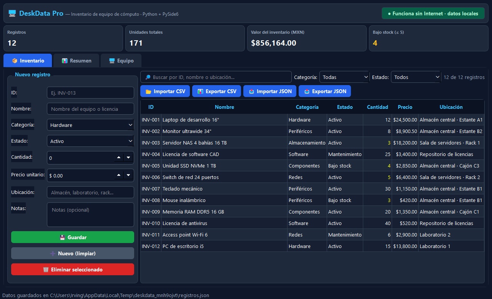
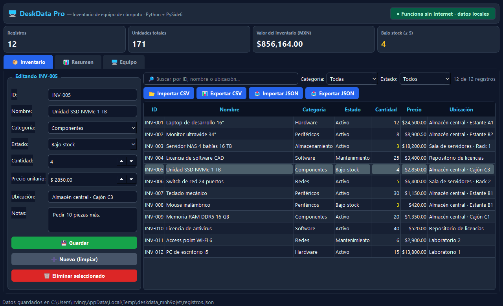
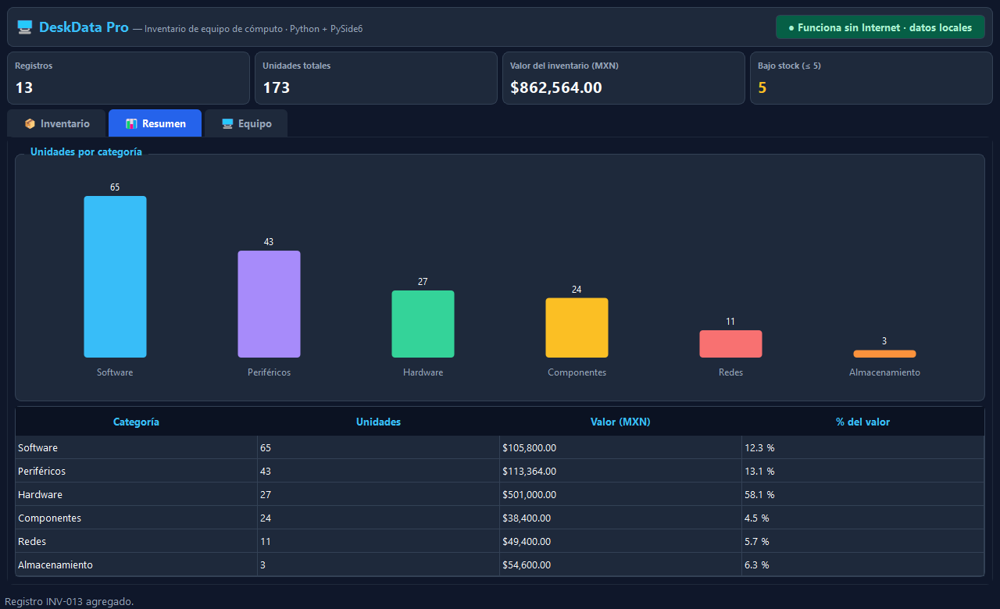
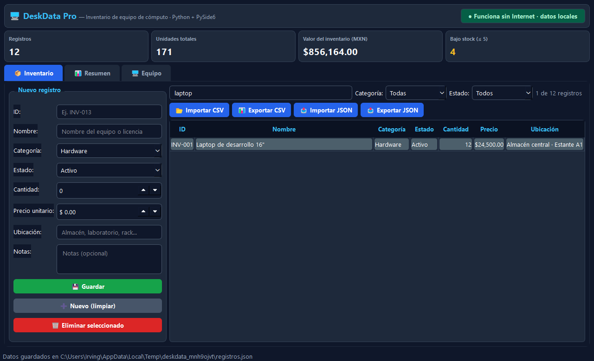
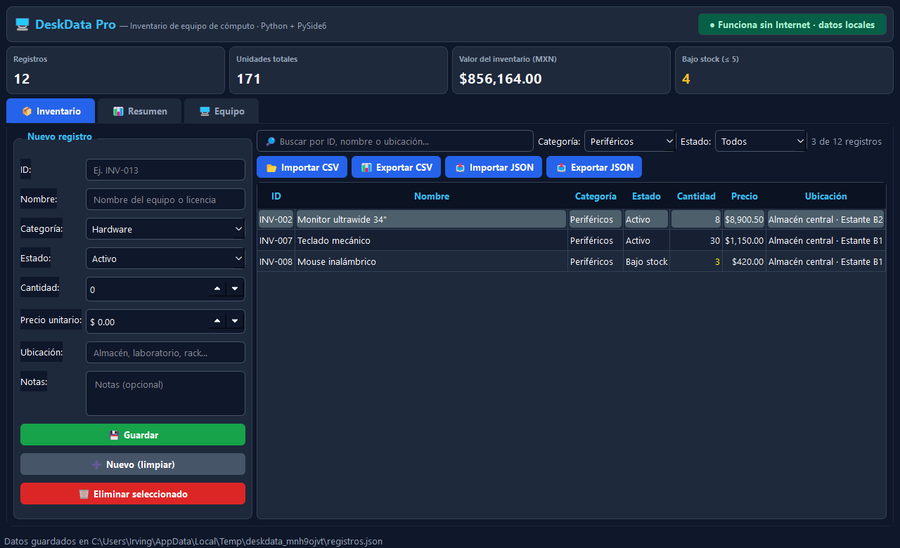
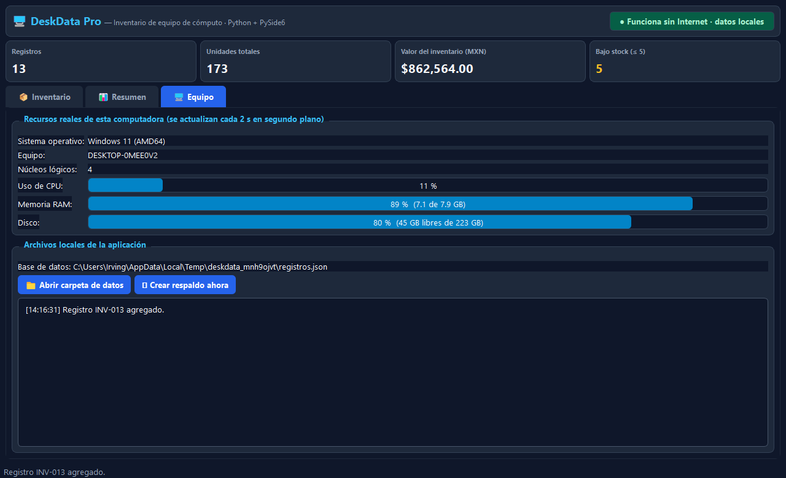

# 🖥️ DeskData Pro — Aplicación de escritorio

Aplicación de **escritorio para Windows** hecha con **Python + PySide6 (Qt)** para llevar el inventario de equipo de cómputo de un laboratorio u oficina. Se ejecuta en la PC, **funciona sin Internet**, guarda sus datos en archivos locales (JSON y CSV), usa los diálogos nativos de Windows y muestra los recursos reales del equipo.

> Subproducto No. 3 · Aplicaciones Web Progresivas · Unidad I
> Universidad Tecnológica de Puebla · Jahir Jaziel Serrano Arana · 10° D

## ⬇️ Descargar
**https://github.com/JazyelAe/App_de_Escritorio/releases/tag/v1.0.0** → `DeskDataPro.exe` (Windows 10/11, no requiere Python).
Como el .exe no está firmado digitalmente, Windows SmartScreen puede avisar: *Más información → Ejecutar de todas formas*.

## Funciones
| | Función |
|---|---|
| 📦 | Tabla de inventario con alta, edición y eliminación (con confirmación) |
| 💾 | Guardado automático en `%APPDATA%\DeskDataPro\registros.json` y respaldos |
| 📂 | Importar / exportar **CSV** y **JSON** con el diálogo de archivos de Windows |
| 🔎 | Búsqueda por texto y filtros por categoría y estado |
| 📊 | Resumen con gráfica de barras por categoría (QPainter) y totales |
| 🖥️ | CPU, RAM y disco **reales** (psutil) medidos en un hilo en segundo plano |

## ¿Por qué es una aplicación de escritorio?
- Se **instala o copia en la computadora** y se ejecuta como un programa de Windows (.exe), con su ventana e icono.
- **No necesita Internet ni navegador**: trabaja con archivos y recursos locales del sistema operativo.
- Usa componentes nativos: diálogos de archivos, cuadros de mensaje, carpeta de datos del usuario y hardware del equipo.

## Tecnologías
Python 3.13 · PySide6 6.12 (Qt 6) · psutil 7.2 · JSON / CSV · PyInstaller 6.22 · GitHub Actions (windows-latest) + Releases

## Estructura
```
main.py            arranque y opciones (--capturas, --self-test, --datos)
ventana.py         ventana principal y pestañas
grafica.py         gráfica de barras con QPainter
models.py          datos: JSON, CSV, respaldos, filtros y estadísticas
worker_service.py  hilo de monitoreo con psutil
capturas.py        modo --capturas (QWidget.grab)
datos/             semilla.json (datos iniciales) y ejemplo_importar.csv
```

## Cómo ejecutarla desde el código
```
pip install -r requirements.txt
python main.py
```
- `python main.py --self-test` prueba la lógica (alta/edición/baja, CSV, filtros, resumen, psutil).
- `python main.py --capturas` genera las imágenes de `docs/capturas/` con datos de ejemplo (no toca tus datos).
- `construir.bat` crea `dist\DeskDataPro.exe` con PyInstaller.

## Capturas
| Inventario | Edición | Resumen |
|---|---|---|
|  |  |  |
| **Búsqueda** | **Filtro** | **Equipo (recursos reales)** |
|  |  |  |

## Documentación
- Especificación y pruebas: [SPEC.md](SPEC.md)
- Repositorio central de la unidad: https://github.com/JazyelAe/AWP-Unidad-I
